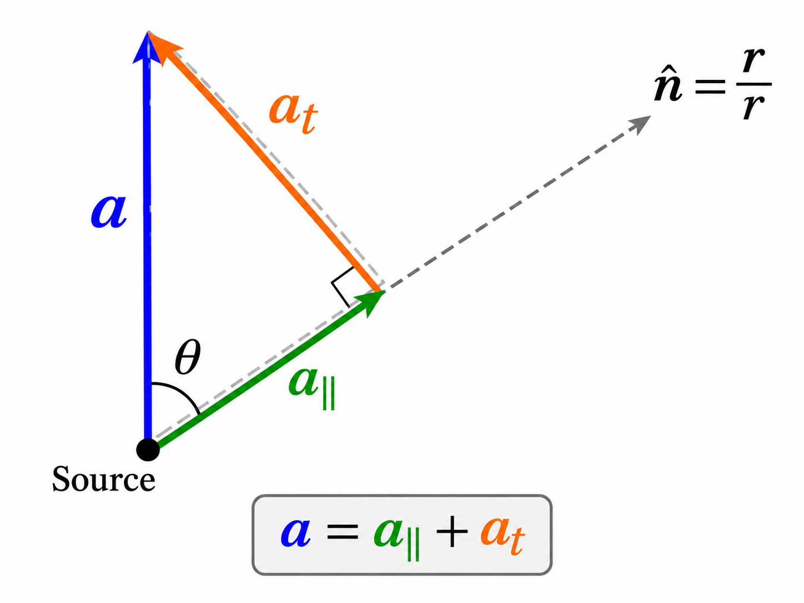

## 0. Introduction

[이 글에서는 $e^{-i\omega t}$ 형태의 time convention 을 사용한다.]{style="color: red;"}

[이 글에서는 Heaviside–Lorentz units 을 사용한다.]{style="color: red;"}

이 포스트에서는 전자파 복사의 기본원리와 우리가 알고있는 전자파 복사의 엄밀한 수학적 유도를 다루겠다. 

또한, 비 상대론적 전자파 복사에 대한 내용을 다루고 추후에 상대론적 전자파 복사에 대한 내용을 다루겠다.

## 1. Governing equations in inhomogeneous wave equation

Heaviside–Lorentz units 헤비사이드–로런츠 단위계는 전자기학에서 사용되는 단위계 중 하나로, 전자파의 전자기장을 표현할때 절대적 물리량인 빛으로 표현해 수학적으로 매우 간단히 기술할수 있다. 

헤비사이드–로런츠 단위계를 적용한 맥스웰 방정식은 다음과 같다.

$$
\nabla\cdot\mathbf E=\rho,\quad
\nabla\cdot\mathbf B=0,\quad
\nabla\times\mathbf{E}=-\frac{1}{c}\partial_{t}\mathbf{B},\quad
\nabla\times\mathbf{B}=\frac{\mathbf{J}}{c} + \frac{1}{c}\partial_{t}\mathbf{E}
$$ {#eq-maxwell}

Inhomogeneous wave equation 에서

$$
\left(\frac{1}{c^2}\partial_t^2-\nabla^2\right)\mathbf{E}
=-\frac{1}{c^2}\partial_t\mathbf{J}-\nabla\rho,
\quad \partial_t\rho + \nabla\cdot\mathbf{J}=0
$$ {#eq-wave}

여기서 $\rho$ 와 $\mathbf{J}$ 는 각각 전하 밀도와 전류 밀도이고 주어지는 값이고 $\mathbf{E}$ 와 $\mathbf{B}$ 는 우리가 구해야할 값이고 맥스웰 방정식에 따라 $\mathbf{E}$ 를 구하면 $\mathbf{B}$는 자동결정 된다.

식 [-@eq-wave]를 푸리에 변환 하면.

$$
(-\frac{\omega^2}{c^2}+k^2)\mathbf{E}=\frac{i\omega}{c^2}\mathbf{J}-i\mathbf{k}\rho,\quad i\omega\rho-i\mathbf{k}\cdot\mathbf{J}=0
$$ {#eq-wave-fourier}

연속 방정식이 계속 따라다니는 이유는 추후 운동량 포스트에서 정리하겠지만. 맥스웰 방정식을 검산 하는 좋은 수단이 될 수 있다.

식 [-@eq-wave-fourier]를 필드와 소스 term 을 묶어서 나머지를 연산자 취급하게 되면 일반해와 특수해를 구하는 비제차 미분방정식을 푸는 셈이 된다.

c : complementary solution, p : particular solution

$$
(-\frac{\omega^2}{c^2}+k^2)\mathbf{E}_c=0,\quad
(-\frac{\omega^2}{c^2}+k^2)\mathbf{E}_p=\frac{i\omega}{c^2}\mathbf{J}-i\mathbf{k}\rho,\quad \mathbf{E} = \mathbf{E}_c + \mathbf{E}_p
$$

이때 $\mathbf{B}$ 도 같은 맥락으로

$$
\nabla\times\mathbf{E}=-\frac{1}{c}\partial_{t}\mathbf{B}\rightarrow\mathbf{B}=\frac{c}{\omega}\mathbf{k}\times\mathbf{E},\;\;\text{and}\;\;
\mathbf{B}=\mathbf{B_c} + \mathbf{B_p}=\frac{c}{\omega}\mathbf{k}\times\mathbf{E_c} + \frac{c}{\omega}\mathbf{k}\times\mathbf{E_p}
$$

## 2. Electric field $\mathbf{E}_p$

$$
\mathbf{E}_p = \frac{i\frac{\omega}{c^2}\mathbf{J}-i\\mathbf{k}\rho}{-\frac{\omega^2}{c^2}+k^2}
\quad \text{\&} \quad
\rho = \frac{\mathbf{k}\cdot\mathbf{J}}{\omega}\;\rightarrow\;\mathbf{E}_p = \frac{i\frac{\omega}{c^2}\mathbf{J}-i\frac{\mathbf{k}(\mathbf{k}\cdot\mathbf{J})}{\omega}}{-\frac{\omega^2}{c^2}+k^2}=\underbrace{-i\omega\frac{\mathbf{J}}{\omega^2-c^2k^2}}_{\mathbf{E}_{p1}} + \underbrace{i\omega\frac{c^2}{\omega^2}\frac{\mathbf{k}(\mathbf{k}\cdot\mathbf{J})}{\omega^2-c^2k^2}}_{\mathbf{E}_{p2}}
$$ {#eq-E_field}

이때 $\omega^2-c^2k^2=0$ 인 경우를 생각해보자 2개의 pole 점이 발생한다. 이때 직관을 믿으면 하나는 outgoing wave, 하나는 incoming wave 일것이다, 일단 이정도로만 의심하고 더욱 엄밀한 증명을 해보자.

점전하에 의해 발생하는 전류를 $\mathbf{J(\mathbf{r},t)}=q\delta(\mathbf{r}-\mathbf{x}(t))\frac{dx(t)}{dt}$ 라고 하자. 추가로 점전하가 움직이는 경로의 자취를 따라 계산되므로 관측점이 어디에 있든지 상관없이 점전하가 움직이는 경로를 따라 계산되므로 상대론적으로도 맞는 표현이다.

하지만 비 상대론적 전자파 복사를 가정하므로 $|\mathbf{x}(t)|\ll\lambda$ 인 상황으로 가정한다 (상대론적으로는 틀린 표현이지만 비상대론적으로는 유용한 표현이다)

따라서 점전하에 의해 발생하는 전류는 $\mathbf{J(\mathbf{r},t)}=q\delta(\mathbf{r})v(t)$ 가 된다.

푸리에 변환하면, 
$$
\mathbf{J}(\mathbf{k},\omega) = \int d\mathbf{r}dt\mathbf{J}(\mathbf{r},t) e^{-i(\mathbf{k}\cdot\mathbf{r}-\omega t)} = \int dt qv(t)e^{i\omega t} = qv(\omega)
$$

이제 특수해 소스 term $\mathbf{E}_{p1}$ 에 대입하여 실공간 으로 푸리에 역변환 하면

$$
\mathbf{E}_{p1}(\mathbf{r},t) = -iq\int \frac{d\mathbf{k}d\omega}{(2\pi)^4} \frac{\omega v(\omega)e^{i(\mathbf{k}\cdot\mathbf{r}-\omega t)}}{\omega^2-c^2k^2} =\frac{iq}{c^2} \int \frac{d\omega}{2\pi}\omega v(\omega)e^{-i\omega t}\color{red}{\int \frac{d\mathbf{k}}{(2\pi)^3} \frac{e^{i\mathbf{k}\cdot\mathbf{r}}}{k^2-\frac{\omega^2}{c^2}}}
$$

$$
d\mathbf{k} = k^2\sin\theta\,dk\,d\theta\,d\phi,\;\mathbf{k}\cdot\mathbf{r} = kr\cos\theta,\; \eta = \cos\theta 
$$

$$
{\color{red}
\int \frac{d\mathbf{k}}{(2\pi)^3}
\frac{e^{i\mathbf{k}\cdot\mathbf{r}}}{k^2-\frac{\omega^2}{c^2}}
}
= \frac{1}{(2\pi)^2}\int_0^\infty k^2dk
\int_{-1}^{1}d\eta
\frac{e^{ikr\eta}}{k^2-\frac{\omega^2}{c^2}}
= \frac{1}{(2\pi)^2}\int_0^\infty dk\frac{k^2}{k^2-\frac{\omega^2}{c^2}}\frac{e^{ikr}-e^{-ikr}}{ikr}
$$

먼저 지수함수의 두 항을 분리하면

$$
\begin{aligned}
&\frac{1}{(2\pi)^2}\int_0^\infty dk\,
\frac{k^2}{k^2-\frac{\omega^2}{c^2}}
\frac{e^{ikr}-e^{-ikr}}{ikr}\\
&=\frac{1}{(2\pi)^2ir}
\left[
\int_0^\infty dk\,\frac{ke^{ikr}}{k^2-\frac{\omega^2}{c^2}}
-
\int_0^\infty dk\,\frac{ke^{-ikr}}{k^2-\frac{\omega^2}{c^2}}
\right].
\end{aligned}
$$

두 번째 적분에서 $k=-q$로 치환한다. 이때 $dk=-dq$이며,
적분구간은 $k:0\to\infty$에서 $q:0\to-\infty$로 바뀐다.

$$
\begin{aligned}
\int_0^\infty dk\,\frac{ke^{-ikr}}{k^2-\frac{\omega^2}{c^2}}
&=\int_0^{-\infty}(-dq)\,
\frac{(-q)e^{iqr}}{q^2-\frac{\omega^2}{c^2}}\\
&=\int_0^{-\infty}dq\,
\frac{qe^{iqr}}{q^2-\frac{\omega^2}{c^2}}\\
&=-\int_{-\infty}^{0}dq\,
\frac{qe^{iqr}}{q^2-\frac{\omega^2}{c^2}}.
\end{aligned}
$$

따라서 두 번째 적분 앞의 음수 부호가 상쇄된다.
적분변수 $q$를 다시 $k$로 표기하면

$$
\begin{aligned}
&\frac{1}{(2\pi)^2ir}
\left[
\int_0^\infty dk\,\frac{ke^{ikr}}{k^2-\frac{\omega^2}{c^2}}
+
\int_{-\infty}^{0}dk\,\frac{ke^{ikr}}{k^2-\frac{\omega^2}{c^2}}
\right]\\
&=\frac{1}{(2\pi)^2ir}
\int_{-\infty}^{\infty}dk\,
\frac{ke^{ikr}}{k^2-\frac{\omega^2}{c^2}}\\
&=\frac{1}{(2\pi)^2ir}
\int_{-\infty}^{\infty}dk\,
\frac{ke^{ikr}}
{\left(k-\frac{\omega}{c}\right)\left(k+\frac{\omega}{c}\right)}.
\end{aligned}
$$

$$
\frac{1}{(2\pi)^2ir}
\int_{-\infty}^{\infty}dk\,
\frac{ke^{ikr}}
{\left(k-\frac{\omega}{c}\right)\left(k+\frac{\omega}{c}\right)}\rightarrow \frac{e^{i\omega r/c}}{4\pi r} \quad \text{(outgoing wave)}\quad
$$

## 3. Residue theorem

앞에서 변수 치환을 통해 적분구간을 실수축 전체로 확장하였다.
이 형태에서는 복소평면에 폐곡선을 구성하여 유수정리(residue theorem)를
적용할 수 있다.

이제 $k_0=\omega/c>0$, $r=|\mathbf{r}|>0$로 놓자.
계산할 공간 적분은 다음과 같다.

$$
\frac{1}{(2\pi)^2ir}
\int_{-\infty}^{\infty}dk\,
\frac{ke^{ikr}}{(k-k_0)(k+k_0)}.
$$

다만 $k=\pm k_0$에 극점이 있으므로, 실수축을 그대로 통과하는 적분은
통상적인 이상적분으로 정의되지 않는다.
따라서 원하는 경계조건에 맞추어 극점을 처리해야 한다.

시간 의존성을 $e^{-i\omega t}$로 선택하면,
원점에서 바깥으로 진행하는 outgoing wave의 공간 의존성은
$e^{ik_0r}$이다. 이 방사 경계조건에 해당하는 극점 처방은

$$
k^2-k_0^2
\;\longrightarrow\;
k^2-(k_0+i\epsilon)^2,
\qquad \epsilon>0,\quad \epsilon\to0^+
$$

이다. 이에 따라 계산할 적분은

$$
\lim_{\epsilon\to0^+}
\frac{1}{(2\pi)^2ir}
\int_{-\infty}^{\infty}dk\,
\frac{ke^{ikr}}
{(k-k_0-i\epsilon)(k+k_0+i\epsilon)}
$$

가 된다. 두 극점의 위치는 각각

$$
k_+=k_0+i\epsilon,
\qquad
k_-=-k_0-i\epsilon
$$

이므로, 양의 극점은 상반평면에, 음의 극점은 하반평면에 놓인다.

복소 적분변수를 $z=x+iy$로 쓰면 지수함수는

$$
e^{izr}=e^{ixr}e^{-yr}
$$

이다. $r>0$이므로 상반평면($y>0$)에서 지수함수가 감쇠한다.
따라서 실수축을 $-R$에서 $R$까지 지난 후 상반평면의 반원으로
돌아오는 반시계 방향 폐곡선을 선택한다.
$R\to\infty$에서 반원 위의 적분은 Jordan lemma에 의해 사라진다.

이 폐곡선 내부에는 $z=k_0+i\epsilon$의 극점 하나만 포함된다.
적분함수를

$$
f_\epsilon(z)=
\frac{ze^{izr}}
{(z-k_0-i\epsilon)(z+k_0+i\epsilon)}
$$

으로 정의하면, 이 단순극점에서의 유수는

$$
\begin{aligned}
\operatorname{Res}\left(f_\epsilon,k_0+i\epsilon\right)
&=\lim_{z\to k_0+i\epsilon}
(z-k_0-i\epsilon)f_\epsilon(z)=\left.
\frac{ze^{izr}}{z+k_0+i\epsilon}
\right|_{z=k_0+i\epsilon}\\\\
&=\frac{(k_0+i\epsilon)e^{i(k_0+i\epsilon)r}}
{2(k_0+i\epsilon)}=\frac{1}{2}e^{i(k_0+i\epsilon)r}.
\end{aligned}
$$

따라서 유수정리를 적용하면

$$
\begin{aligned}
\int_{-\infty}^{\infty}dk\,
\frac{ke^{ikr}}
{(k-k_0-i\epsilon)(k+k_0+i\epsilon)}
&=2\pi i\,
\operatorname{Res}\left(f_\epsilon,k_0+i\epsilon\right)\\\\
&=\pi i\,e^{i(k_0+i\epsilon)r}.
\end{aligned}
$$

앞의 계수를 곱하고 $\epsilon\to0^+$의 극한을 취하면,
outgoing 경계조건에 해당하는 공간 적분은

$$
\begin{aligned}
\lim_{\epsilon\to0^+}
\frac{1}{(2\pi)^2ir}
\int_{-\infty}^{\infty}dk\,
\frac{ke^{ikr}}
{(k-k_0-i\epsilon)(k+k_0+i\epsilon)}
&=\lim_{\epsilon\to0^+}
\frac{\pi i}{(2\pi)^2ir}
e^{ik_0r}e^{-\epsilon r}\\\\
&=\frac{e^{ik_0r}}{4\pi r}
=\frac{e^{i\omega r/c}}{4\pi r}.
\end{aligned}
$$

## 4.  Radiation from an Accelerating Charge 

$$
\mathbf{E}_{p1}(\mathbf{r},t)=\frac{iq}{c^2}\int_{-\infty}^\infty\frac{d\omega}{2\pi}\omega\mathbf{v}(\omega)e^{-i\omega t}
\frac{e^{\frac{i\omega r}{c}}}{4\pi r}
=-\frac{q}{4\pi c^2 r}\int^\infty_{-\infty}\frac{d\omega}{2\pi}(-i\omega)\mathbf{v}(\omega)e^{-i\omega(t-\frac{r}{c})} 
$$

여기서 푸리에 변환의 직관을 발휘해서 $-i\omega$ 를 시간의 미분인게 보인다면.
$$
-\frac{q}{4\pi c^2 r}\int^\infty_{-\infty}\frac{d\omega}{2\pi}(-i\omega)\mathbf{v}(\omega)e^{-i\omega(t-\frac{r}{c})} 
=-\frac{q\frac{d\mathbf{v}(t-\frac{r}{c})}{dt}}{4\pi c^2 r}
=-\frac{q\mathbf{a}(t-\frac{r}{c})}{4\pi c^2 r}
$$

한편 특수해의 두 번째 항 $\mathbf{E}_{p2}$의 원거리 방사장 부분은 다음과 같다.

$$
\begin{aligned}
\mathbf{E}_{p2}(\mathbf{r},t)
&\simeq iq\int\frac{d\omega\,d^3\mathbf{k}}{(2\pi)^4}
\frac{\omega\hat{\mathbf{k}}
\bigl(\hat{\mathbf{k}}\cdot\mathbf{v}(\omega)\bigr)
e^{i(\mathbf{k}\cdot\mathbf{r}-\omega t)}}
{\omega^2-c^2k^2}\\\\
&=-\frac{iq}{c^2}\int\frac{d\omega}{2\pi}\,
\omega e^{-i\omega t}
\left[
\int\frac{d^3\mathbf{k}}{(2\pi)^3}
\frac{e^{i\mathbf{k}\cdot\mathbf{r}}}
{\left(k-\frac{\omega}{c}\right)
 \left(k+\frac{\omega}{c}\right)}
\hat{\mathbf{k}}\hat{\mathbf{k}}
\right]\cdot\mathbf{v}(\omega).
\end{aligned}
$$

여기서 $\hat{\mathbf{k}}\hat{\mathbf{k}}$는 다이애딕 곱(dyadic product)으로,
벡터의 $\hat{\mathbf{k}}$ 방향 성분을 추출한다.

$$
\bigl(\hat{\mathbf{k}}\hat{\mathbf{k}}\bigr)\cdot\mathbf{v}
=\hat{\mathbf{k}}\bigl(\hat{\mathbf{k}}\cdot\mathbf{v}\bigr).
$$

각도 적분을 위해 관측 방향 $\mathbf{r}$을 $z$축으로 선택하면,
$r=|\mathbf{r}|$에 대해

$$
\mathbf{k}\cdot\mathbf{r}=kr\cos\theta,
\qquad
\hat{\mathbf{k}}
=
\begin{pmatrix}
\sin\theta\cos\phi\\
\sin\theta\sin\phi\\
\cos\theta
\end{pmatrix}
$$

이므로 다이애딕 곱은 다음과 같다.

$$
\hat{\mathbf{k}}\hat{\mathbf{k}}
=
\begin{pmatrix}
\sin^2\theta\cos^2\phi&
\sin^2\theta\cos\phi\sin\phi&
\sin\theta\cos\theta\cos\phi\\
\sin^2\theta\cos\phi\sin\phi&
\sin^2\theta\sin^2\phi&
\sin\theta\cos\theta\sin\phi\\
\sin\theta\cos\theta\cos\phi&
\sin\theta\cos\theta\sin\phi&
\cos^2\theta
\end{pmatrix}.
$$

지수함수와 분모는 $\phi$에 의존하지 않으며,
$0\leq\phi\leq2\pi$에서 $\sin\phi$, $\cos\phi$,
$\sin\phi\cos\phi$의 적분은 모두 0이다.
따라서 비대각 성분은 적분 후 사라지고 대각 성분만 남는다.

구면좌표의 체적 요소와 변수 치환

$$
d^3\mathbf{k}=k^2\,dk\,\sin\theta\,d\theta\,d\phi,
\qquad
\eta=\cos\theta
$$

를 이용하면, $xx$, $yy$ 성분은
$\int_0^{2\pi}\cos^2\phi\,d\phi
=\int_0^{2\pi}\sin^2\phi\,d\phi=\pi$이므로

$$
\begin{aligned}
&\int\frac{d^3\mathbf{k}}{(2\pi)^3}
\frac{e^{i\mathbf{k}\cdot\mathbf{r}}}
{k^2-\frac{\omega^2}{c^2}}
\sin^2\theta\cos^2\phi\\\\
&\qquad=
\int\frac{d^3\mathbf{k}}{(2\pi)^3}
\frac{e^{i\mathbf{k}\cdot\mathbf{r}}}
{k^2-\frac{\omega^2}{c^2}}
\sin^2\theta\sin^2\phi\\\\
&\qquad=
\frac{\pi}{(2\pi)^3}
\int_0^\infty dk\,
\frac{k^2}{k^2-\frac{\omega^2}{c^2}}
\int_{-1}^{1}d\eta\,e^{ikr\eta}(1-\eta^2)
\end{aligned}
$$

가 된다. 반면 $zz$ 성분은

$$
\begin{aligned}
&\int\frac{d^3\mathbf{k}}{(2\pi)^3}
\frac{e^{i\mathbf{k}\cdot\mathbf{r}}}
{k^2-\frac{\omega^2}{c^2}}
\cos^2\theta\\\\
&\qquad=
\frac{2\pi}{(2\pi)^3}
\int_0^\infty dk\,
\frac{k^2}{k^2-\frac{\omega^2}{c^2}}
\int_{-1}^{1}d\eta\,e^{ikr\eta}\eta^2
\end{aligned}
$$

이다. 여기서 필요한 각도 적분은

$$
\int_{-1}^{1}d\eta\,e^{ikr\eta}
=\frac{e^{ikr}-e^{-ikr}}{ikr}
$$

과

$$
\begin{aligned}
\int_{-1}^{1}d\eta\,e^{ikr\eta}\eta^2
&=-\frac{d^2}{d(kr)^2}
\left(\frac{e^{ikr}-e^{-ikr}}{ikr}\right)\\\\
&=\frac{e^{ikr}-e^{-ikr}}{ikr}
+\frac{2(e^{ikr}+e^{-ikr})}{k^2r^2}
+\frac{2i(e^{ikr}-e^{-ikr})}{k^3r^3}
\end{aligned}
$$

이다. 따라서 $xx$, $yy$ 성분에서는 $1/(kr)$ 항이 상쇄되어

$$
\int_{-1}^{1}d\eta\,e^{ikr\eta}(1-\eta^2)
=
-\frac{2(e^{ikr}+e^{-ikr})}{k^2r^2}
-\frac{2i(e^{ikr}-e^{-ikr})}{k^3r^3}
$$

가 되고, $zz$ 성분에는 $1/(kr)$ 항이 남는다.

이러한 거리 의존성은 근접장과 방사장을 구분하는 기준이 된다.
남은 적분을 수행하고 전체 전기장을 구성했을 때,
$1/r^3$ 항은 정전기적 근접장(quasi-static field),
$1/r^2$ 항은 유도장(induction field),
$1/r$ 항은 방사장(radiation field)에 해당한다.
정전기적 근접장은 시간에 따라 변할 수 있으므로 반드시 DC를 의미하지는 않는다.

방사 전기장과 자기장은 모두 $1/r$로 감소하므로,
시간 평균 포인팅 벡터는 $1/r^2$에 비례한다.

$$
\left\langle\mathbf{S}\right\rangle
=\frac{c}{2}\operatorname{Re}
\left(
\mathbf{E}_{\mathrm{rad}}\times\mathbf{B}_{\mathrm{rad}}^*
\right)
\propto\frac{1}{r^2}.
$$

반면 구면의 면적은 $r^2$에 비례하므로,
구면 전체를 통과하는 시간 평균 방사 전력은
원거리에서 거리 $r$에 무관하게 유지된다.

$$
P_{\mathrm{rad}}
=\int_{4\pi}
\left\langle\mathbf{S}\right\rangle\cdot\hat{\mathbf{r}}\,
r^2\,d\Omega
\propto r^0.
$$

따라서 $1/r$ 방사장은 무한히 먼 곳까지 유한한 전력을 전달할 수 있다.
반면 더 빠르게 감소하는 근접장 항의 전력 기여는
$r\to\infty$에서 사라진다.
그러므로 이후에는 원거리 방사장을 구하기 위해 $1/r$ 항만 남긴다.

따라서 나머지 계산은 $\mathbf{E}_{p1}$ 을 구했던 것 처럼 계산하면 $\mathbf{E}_{p2}$ 는
$$
\mathbf{E}_{p2}(\mathbf{r},t) = \frac{q\mathbf{a}(t-\frac{r}{c})\cdot\hat{n}\hat{n}}{4\pi c^2 r},\text{where}\;\mathbf{r}\equiv r\hat{n} 
$$

총 전기장의 해를 구하면

$$
\mathbf{E}_p = \mathbf{E}_{p1} + \mathbf{E}_{p2} = -\frac{q\mathbf{a}(t-\frac{r}{c})}{4\pi c^2 r} + \frac{q\mathbf{a}(t-\frac{r}{c})\cdot\hat{n}\hat{n}}{4\pi c^2 r}
= -\frac{q\mathbf{a}_t(t-\frac{r}{c})}{4\pi c^2 r}
$$

$$
\mathbf{a}_t \equiv \mathbf{a}-\hat{n}\hat{n}\cdot\mathbf{a} = -\hat{n}\times(\hat{n}\times\mathbf{a}),\text{transverse component of acceleration}
$$

{#fig-acceleration width=500}

여기서 **Retarded Time** $t_r=t-\frac{r}{c}$은 전하의 가속에 의해 발생한 전자기파가 유한한 속도 $c$로 전파되어 관측점에 도달하기까지 시간 지연이 발생한다는 것을 의미한다.

또한 방사 전기장은 전하의 전체 가속도가 아닌 **관측 방향에 수직인 가속도 성분(Transverse Acceleration)**에 의해서만 결정된다.

따라서 관측자가 전하의 가속 방향과 평행한 위치에 있다면 원거리 방사 에너지를 전달받지 못하지만, 가속 방향에 수직인 위치에서는 최대의 방사 에너지를 전달받는다.

## 5. Magnetic field $\mathbf{B}_p$

이제 전기장을 다 구했으니 자기장을 구해보자.  [-@eq-E_field] 식에서 $\mathbf{B}_p = \frac{c}{\omega}\mathbf{k}\times\mathbf{E}_p$ 관계를 사용하면.

$$
\mathbf{B}_p = -ic \frac{\mathbf{k}\times\mathbf{J}}{\omega^2-c^2k^2} = -iqc\frac{\mathbf{k}\times\mathbf{v}}{\omega^2-c^2k^2}
$$

이를 실공간으로 넘기기위해 푸리에 역변환 하면

$$
\mathbf{B}_p(\mathbf{r},t) = -iqc\int \frac{d\omega d\mathbf{k}}{(2\pi)^4} 
\frac{\mathbf{k}\times\mathbf{v}(\omega)e^{i(\mathbf{k}\cdot\mathbf{r}-\omega t)}}{\omega^2-c^2k^2}
$$

전기장을 구할 때와 같이 분모를 정리하면

$$
\mathbf{B}_p(\mathbf{r},t)
=-\frac{iq}{c}\int\frac{d\omega}{2\pi}\,
e^{-i\omega t}\mathbf{v}(\omega)\times
\int\frac{d^3\mathbf{k}}{(2\pi)^3}
\frac{\mathbf{k}e^{i\mathbf{k}\cdot\mathbf{r}}}
{k^2-\frac{\omega^2}{c^2}}.
$$

관측 방향 $\hat{\mathbf{n}}$을 $z$축으로 잡고 $\eta=\cos\theta$로 두면,
$\phi$ 적분에서 관측 방향에 수직인 성분은 사라진다. 따라서

$$
\int\frac{d^3\mathbf{k}}{(2\pi)^3}
\frac{\mathbf{k}e^{i\mathbf{k}\cdot\mathbf{r}}}
{k^2-\frac{\omega^2}{c^2}}
=
\frac{\hat{\mathbf{n}}}{(2\pi)^2}
\int_0^\infty dk\,
\frac{k^3}{k^2-\frac{\omega^2}{c^2}}
\int_{-1}^{1}d\eta\,\eta e^{ikr\eta}.
$$

여기서 각도 적분은

$$
\int_{-1}^{1}d\eta\,\eta e^{ikr\eta}
=
\frac{e^{ikr}+e^{-ikr}}{ikr}
+\frac{e^{ikr}-e^{-ikr}}{k^2r^2}
$$

이다. 원거리에서 $1/r$에 비례하는 방사장 항만 남기고,
앞서 전기장에서 사용한 outgoing-wave 극점 처방으로 적분하면

$$
\begin{aligned}
\int\frac{d^3\mathbf{k}}{(2\pi)^3}
\frac{\mathbf{k}e^{i\mathbf{k}\cdot\mathbf{r}}}
{k^2-\frac{\omega^2}{c^2}}
&\simeq
\frac{\hat{\mathbf{n}}}{(2\pi)^2ir}
\int_0^\infty dk\,
\frac{k^2(e^{ikr}+e^{-ikr})}
{k^2-\frac{\omega^2}{c^2}}\\\\
&=
\frac{\hat{\mathbf{n}}}{(2\pi)^2ir}
\int_{-\infty}^{\infty}dk\,
\frac{k^2e^{ikr}}
{\left(k-\frac{\omega}{c}\right)
 \left(k+\frac{\omega}{c}\right)}\\\\
&=
\frac{\hat{\mathbf{n}}}{(2\pi)^2ir}
\,2\pi i\,\frac{\omega}{2c}e^{i\omega r/c}\\\\
&=
\frac{\omega}{4\pi cr}
e^{i\omega r/c}\hat{\mathbf{n}}.
\end{aligned}
$$

이를 대입하고 외적의 순서를 바꾸면

$$
\begin{aligned}
\mathbf{B}_p(\mathbf{r},t)
&\simeq
\frac{iq}{4\pi c^2r}\,
\hat{\mathbf{n}}\times
\int\frac{d\omega}{2\pi}\,
\omega\mathbf{v}(\omega)
e^{-i\omega(t-r/c)}\\\\
&=
-\frac{q}{4\pi c^2r}\,
\hat{\mathbf{n}}\times
\int\frac{d\omega}{2\pi}\,
(-i\omega)\mathbf{v}(\omega)
e^{-i\omega(t-r/c)}\\\\
&=
-\frac{q}{4\pi c^2r}\,
\hat{\mathbf{n}}\times
\mathbf{a}\left(t-\frac{r}{c}\right).
\end{aligned}
$$

앞서 구한 전기장의 방사장과 비교하면, 원거리에서

$$

\mathbf{B}_p(\mathbf{r},t)
= \hat{\mathbf{n}}\times\mathbf{E}_p(\mathbf{r},t)

$$

이다. 따라서 자기장은 전기장과 진행 방향 모두에 수직하며,
$\mathbf{E}_p\times\mathbf{B}_p$는 바깥쪽 방사 방향을 향한다.

## 6. Reference

[1] J. D. Jackson, *Classical Electrodynamics*, 3rd ed. New York, NY, USA: John Wiley & Sons, 1999.

[2] C.-M. Kim, “PH5001 Advanced Electrodynamics I,” Course Lecture Notes, Gwangju Institute of Science and Technology (GIST), Gwangju, South Korea, n.d.

[3] G. B. Arfken, H. J. Weber, and F. E. Harris, *Mathematical Methods for Physicists: A Comprehensive Guide*, 7th ed. Amsterdam, The Netherlands: Academic Press, 2013.