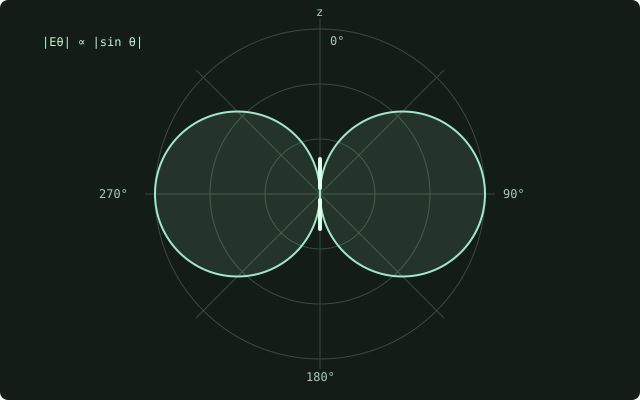

## 처음 한 번만 설치하기

Windows PC에 [VS Code](https://code.visualstudio.com/download), [Git](https://git-scm.com/install/windows), [Quarto](https://quarto.org/docs/get-started/)를 설치하고, VS Code에 **Quarto** 확장을 추가합니다. Markdown과 수식으로 HTML 글을 작성할 때 Python, R, TeX 배포판은 필요하지 않습니다.

```powershell
git clone https://github.com/sonzigusta/sonzigusta.github.io.git
cd sonzigusta.github.io
code .
quarto preview
```

이미 내려받았다면 해당 폴더를 열어주세요. 다른 PC에서 변경했다면 먼저 `git pull`로 최신 내용을 가져옵니다.

## 글과 주제 추가하기

`templates/new-note.qmd`를 복사해서 `posts/글주소/index.qmd`로 저장합니다. 폴더 이름에는 영문 소문자, 숫자, 하이픈을 사용합니다.

```yaml
---
title: "글 제목"
description: "짧은 소개"
date: "2026-11-02"
categories: ["내가 정한 주제"]
draft: false
---
```

`categories`에 원하는 주제명을 자유롭게 적으면 **Notes의 주제 목록에 자동으로 나타납니다.** 여러 주제로 분류하려면 `["주제 하나", "주제 둘"]`처럼 적습니다. 같은 이름을 쓰는 글은 함께 분류됩니다. 고정된 주제 목록이나 별도 JSON 파일을 수정할 필요가 없습니다.

`draft: true`인 글은 사이트에 배포되지 않습니다. 공개 저장소에 커밋한 원고 자체는 공개되므로 비공개 원고는 PC에 보관합니다.

## 수식과 그림

문장 안 수식은 `$k=2\pi/\lambda$`처럼 적습니다. 독립된 수식은 다음과 같이 작성합니다.

```markdown
$$
\nabla\times\mathbf E=-\frac{\partial\mathbf B}{\partial t}
$$ {#eq-faraday}

식 [-@eq-faraday]에서 출발합니다.
```

실제로는 식 [-@eq-writing-faraday]처럼 표시됩니다.

$$
\nabla\times\mathbf E=-\frac{\partial\mathbf B}{\partial t}
$$ {#eq-writing-faraday}

그림은 글 폴더에 넣고 `{#fig-result}`로 추가합니다. 본문에서 `그림 [-@fig-result]`로 참조합니다.

{#fig-writing-dipole width=400}

위 그림 [-@fig-writing-dipole]은 작성 문법을 확인하기 위한 예시입니다. 참고문헌은 `references.bib`에 추가하고 본문에서 `[@tong-em]`처럼 인용합니다. 예: [@tong-em].

## 첫 화면과 디자인 바꾸기

| 바꿀 내용 | 파일 |
|---|---|
| Welcome 소개와 첫 화면 수식 | `index.qmd` |
| 색상, 글꼴, 배너 사진, 글 폭 | `assets/styles.css` |
| Home / Notes / About me 메뉴 | `_quarto.yml`의 `website.navbar` |
| 자기소개 | `about.qmd` |
| 글 목록과 분류 방식 | `notes.qmd` |
| 새 글의 기본 양식 | `templates/new-note.qmd` |

주제별 글을 모으는 일은 각 글의 `categories`만 수정하면 됩니다. 상단에 별도 메뉴를 만들고 싶으면 페이지 `.qmd` 파일을 만든 뒤 `_quarto.yml`의 `project.render`와 `website.navbar.right`에 추가합니다.

```yaml
- text: 원하는 메뉴 이름
  href: my-page.qmd
```

이전 기초 예제 원고 13개는 `_examples/foundation-notes/`에 보관되어 있으며 사이트에는 표시되지 않습니다. 참고할 글을 복사해 `posts/`에 넣을 때는 예전 `topic` 항목을 지우고 `categories`에 원하는 주제명을 적습니다.

## 미리보기와 공개하기

`quarto preview`를 실행하고 파일을 저장하면 내 PC에서 확인할 수 있습니다. 공개하려면 다음을 실행합니다.

```powershell
quarto render
quarto run scripts/check-site.ts
git add .
git commit -m "Update my notes"
git push
```

GitHub **Actions → Build and publish SWR Notes**가 성공하면 사이트에 반영됩니다. `_site/`는 자동 생성 결과물이므로 원본 `.qmd`와 CSS 파일을 수정합니다. 작은 글 수정은 글 페이지의 **Edit this page**로도 할 수 있습니다.
